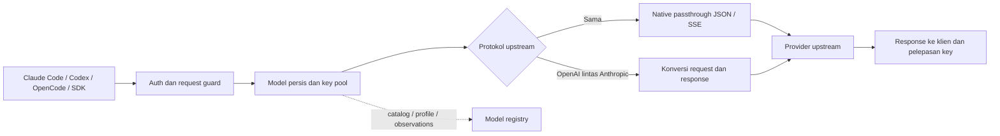

# Finalisasi produksi — 7 Oktober 2026

Ketiga backend aktif kini memiliki model eksplisit yang lulus Claude Code
2.1.202, Codex 0.160.1 dan OpenCode client 1.17.20: **NVIDIA
`nvidia/nemotron-3-super-120b-a12b`**, **Nous
`poolside/laguna-xs-2.1:free`**, dan **OpenRouter
`liquid/lfm-2.5-2.6b:free`**. NVIDIA/Nous lulus melalui **staging terisolasi**,
termasuk native Responses SDK accumulator dan function-call roundtrip;
rollout source terbaru keduanya masih menunggu gate akhir dan verifikasi
proses produksi. OpenRouter dan model-registry sudah memuat source yang
tercatat pada rollout sebelumnya.

Kegagalan Responses native yang ditemukan pada `openai/gpt-oss-20b` dan
`upstage/solar-mini4:free` adalah batas model yang tetap dicatat. Operator
memilih model qualified secara eksplisit; wrapper tidak mengganti model
tersebut secara otomatis. Native passthrough dipertahankan tanpa memperluas
izin adapter. BLACKBOX dan provider OpenCode tetap **pending/frozen**: tidak
dibaca, diedit, diuji, di-probe atau di-rollout sejak freeze owner. Perubahan
lama sebelum freeze dipertahankan. OpenCode client berbeda dari provider
frozen. [AGENTS.md](../AGENTS.md) dan [wrappers.json](../wrappers.json) menjadi
instruksi scope agent berikutnya.

## Workflow dan hasil akhir

Proyek ini adalah gateway AI backend. Klien memilih wrapper, model dan
surface API; credential provider tetap di server. Wrapper mengautentikasi
klien, membatasi body, menyelesaikan alias yang dikonfigurasi, mereservasi
API key, lalu meneruskan request ke provider. Key yang limit/quota/auth gagal
diganti dengan key tersedia untuk **model yang sama**. Exhaustion menghasilkan
error dan informasi retry. Reservasi dilepas pada sukses, error dan cancellation.

| Komponen aktif | Port | Peran |
| --- | ---: | --- |
| NVIDIA | 9101 | Gateway NVIDIA NIM |
| Nous | 9102 | Gateway Nous, API key/OAuth dan metadata provider |
| OpenRouter | 9106 | Gateway OpenRouter, catalog dan management |
| Model registry | 9200 | Control plane profile, alias, catalog dan observasi |
| `common/` | — | Auth, guards, SSE, translation dan state client bersama |

`COMPATIBILITY_LAYER=1` mendeklarasikan upstream OpenAI, `2` Anthropic,
dan `3` discovery. Chat→Chat, Responses→Responses native dan
Messages→Messages native mempertahankan field dan SSE termasuk ekstensi yang
belum dikenal. Konversi dilakukan lintas protokol. Kontrol thinking/adaptive/
effort Claude dipetakan pada Messages→OpenRouter Chat sesuai
[kontrak resmi OpenRouter](https://openrouter.ai/docs/guides/best-practices/reasoning-tokens#reasoning-with-the-anthropic-messages-api).

Sesuai keputusan owner, `RESPONSES_UPSTREAM_MODE=auto` mencoba native dahulu.
Adapter Responses→Chat hanya untuk route definitif tidak didukung (route
404, 405 atau 501); bukan error model, auth, quota, generic 400, 5xx atau
stream 200 invalid. Native history yang tidak dikenal adapter ditolak dengan
petunjuk mengirim context lengkap. Tidak ada perluasan izin untuk bug native.

History adapter berada di memori, dibatasi TTL/jumlah/byte dan namespace
tenant. Gunakan satu worker; restart menghapus history adapter. History native
berada di upstream dan dapat bergantung pada account/key. SQLite menyimpan
catalog/profile/status. Pilih model dengan context, tools dan reasoning sesuai
pekerjaan. Fitur cross conversion dan versi klien baru memerlukan regresi;
kelulusan ini tidak menjamin semua pembaruan masa depan.

## Git dan perbaikan

Baseline `main`, HEAD `1825f876d30feca307ae1198be8e832073b78015`.
Dua commit terakhir, `1825f87` dan `9537519`, menambahkan **laporan audit**,
bukan perbaikan source. Fondasi fix sebelumnya ada pada `002dc18`, `4e2386d`,
`8801e18`, `5bf0dc2` dan `bce2355`. Klaim audit dibandingkan dengan implementasi
dan regresi executable; snapshot audit lama tidak menentukan gate saat ini.

Perbaikan yang difinalisasi:

- Auth Bearer/`x-api-key` menerima credential valid; history mengikuti tenant;
  batas byte body aktual dan JSON `null`→400.
- Native passthrough tidak membuang field/tool/role baru atau mengarang
  terminal sukses; heartbeat tidak menyisip ke tengah frame SSE.
- Cross conversion parallel tools, reasoning, UTF-8 terbelah, EOF,
  continuation dan snapshot sebelum terminal event; thinking Claude terbaru
  dipetakan pada OpenRouter.
- Retry key yang belum dicoba, klasifikasi quota 402, model tetap, exhaustion
  cepat dan cleanup cancellation sebelum headers, termasuk `/v1/models`.
- Metadata Nous yang jujur ketika tags absen; tags caller dipertahankan.
- Registry input/alias batch validation, SQLite di threadpool, bounded drain,
  shutdown cleanup dan fail-closed admin writes.
- Pending scope ditolak sebelum provider I/O oleh installer, supervisor,
  audit dan gate; tes campuran yang membaca provider frozen dikecualikan.
- Dependency runtime aktif konsisten dengan constraint terverifikasi,
  transaksi installer terpilih, env 0600 dan readiness boolean.

Perubahan pengguna yang sudah ada dipertahankan, termasuk audit historis,
runtime markers dan supervisor. Tidak ada commit/push. Git HEAD saja tidak
mengidentifikasi working tree; rollout lokal mencatat fingerprint source dan
waktu proses dimuat. Laporan awal sebelum freeze diarsipkan dalam artefak
historis lokal, bukan dipakai sebagai approval rilis aktif.

## Gate selesai sebelum follow-up NVIDIA/Nous

Gate di bawah telah selesai untuk source rollout OpenRouter sebelumnya,
memakai Python 3.11 terisolasi, fake keys, temporary database dan port
tersendiri. Perbaikan follow-up NVIDIA/Nous memerlukan gate baru sebelum
rollout; angka di tabel ini belum menjadi bukti source follow-up tersebut.
[Artefak gate sebelumnya](../artifacts/production-active-release-20261007/).

| Gate | Hasil | Bukti |
| --- | --- | --- |
| Unit/regression | 521 lulus, 105 excluded karena freeze, 1 deprecation warning library | [unit.log](../artifacts/production-active-release-20261007/unit.log) |
| Runtime active3 × surfaces | 267/267 lulus | [runtime.log](../artifacts/production-active-release-20261007/runtime.log) |
| SDK adapter modes | 12/12 lulus | [sdk.log](../artifacts/production-active-release-20261007/sdk.log) |
| Full matrix | 144/144 lulus, 0 failed/blocked | [matrix.json](../artifacts/production-active-release-20261007/matrix.json) |
| Anthropic dan discovery layers | 45 checks lulus | [compat.log](../artifacts/production-active-release-20261007/compat.log) |
| Native/cross/auto acceptance | 141/141 lulus | [acceptance.json](../artifacts/production-active-release-20261007/acceptance.json) |
| Soak 15 detik × 3, concurrency 6 | 5.930 request sukses, 0 gagal; RSS delta 3/9/10 MB | [soak.log](../artifacts/production-active-release-20261007/soak.log) |
| Native/cross transparency | Lulus | [transparency.log](../artifacts/production-active-release-20261007/transparency.log) |

Fresh dependency resolution lulus 46 paket dengan 0 constraint mismatch;
`pip check` environment terpin bersih. [Bukti resolver](reports/active-dependency-resolver-20261007.json).
Kelulusan gate bukan load/SLA provider asli atau bukti semua model.

Runtime/SDK/matrix/soak memakai mode Chat eksplisit untuk menguji adapter.
Acceptance memeriksa native-first default, opaque JSON/SSE, fallback yang
diizinkan, cross OpenAI/Anthropic, SDK asli, tools/reasoning/history, semua
key gagal dan cancellation. Mock membuktikan perilaku fixture; hasil provider
nyata dicatat terpisah. Tes excluded tidak dihitung sebagai kelulusan.

| Wrapper / model nyata | Hasil |
| --- | --- |
| OpenRouter `liquid/lfm-2.5-2.6b:free` | Native Responses SDK, lintas Messages dan ketiga CLI lulus pada smoke terbatas |
| NVIDIA `nvidia/nemotron-3-super-120b-a12b` | Ketiga CLI staging, native Responses accumulator SDK 2.31/2.54 dan putaran function call→function result lulus; rollout terbaru pending gate |
| Nous `poolside/laguna-xs-2.1:free` | Ketiga CLI staging, native Responses accumulator SDK 2.31/2.54 dan putaran function call→function result lulus; retry 429 nyata pulih melalui key lain dengan model tetap; rollout terbaru pending gate |
| NVIDIA `openai/gpt-oss-20b` | Batas model: Chat/Messages memberi jawaban; indeks content Responses SSE invalid untuk accumulator SDK OpenAI 2.31 dan 2.54 |
| Nous `upstage/solar-mini4:free` | Batas model: Chat/Messages memberi jawaban dengan metadata jujur; Responses native menolak tags valid yang terbukti mencapai transport |

[SDK staging](reports/active-staging-real-sdk-20261007.json),
[diagnosis native](reports/active-native-response-diagnosis-20261007.json),
[CLI staging terbaru](reports/active-client-cli-final-20261007.json).
Laporan menyimpan metadata sanitasi, tanpa key, header auth atau percakapan lengkap.

Kualifikasi baru: [CLI NVIDIA 3/3](reports/nvidia-native-client-qualification-20261007.json),
[tools NVIDIA](reports/nvidia-native-tool-qualification-20261007.json),
[SDK NVIDIA 2.54](reports/nvidia-native-latest-sdk-qualification-20261007.json),
dan [Nous 6/6](reports/nous-native-production-clients-20261007.json).
Nous merekam 11 attempt upstream dari enam pemeriksaan, melibatkan lima
fingerprint credential: attempt 429 pada request non-stream dan stream
akhirnya mendapat 200 melalui credential lain. Semua attempt mempertahankan
`poolside/laguna-xs-2.1:free`; tidak ada adapter Chat pada Responses.
Fingerprint tidak memuat credential asli. Native continuation diuji dengan
history lengkap dan `store=false`; account affinity memakai
`previous_response_id` saat key berubah tetap di luar bukti tersebut.

Claude smoke memakai `--bare`, API key lokal dan output budget 256. Codex smoke
memakai instruksi minimal/context 8192 sebagai batas uji, bukan instruksi
global produksi atau deklarasi kapasitas model. OpenCode memakai Chat dengan
permission tools deny. Putaran tools Nous memakai budget eksplisit 512; budget
setiap request tercatat pada evidence, dan tidak menjadi rekomendasi workload.
[Konfigurasi yang direproduksi](CLIENT_BACKEND_SETUP.md) menjelaskan batasnya.

## Rollout lokal

**OpenRouter dan model-registry telah dimuat ulang dan lulus verifikasi live.**
Model-registry dimuat pada 7 Oktober 2026 **22:09:32 WIB**, PID 3815330;
OpenRouter **22:09:40 WIB**, PID 3815360. Unit/config existing dipertahankan.
NVIDIA/Nous belum di-rollout pada catatan ini: source follow-up dan hasil
staging baru sedang menuju gate akhir. Hasil staging belum membuktikan
proses produksi telah memuat source tersebut. Provider
pending tidak di-probe, dihentikan, dimuat ulang atau diubah.

- Health/readiness, invalid bearer→401, null pada tiga surface→400 dan model
  catalog: **8/8 lulus**. [Bukti rollout](reports/active-production-rollout-20261007.json).
- Claude Code, Codex dan OpenCode client melalui **endpoint produksi 9106**:
  **3/3 lulus**, jawaban OK dan terminal event.
  [Bukti CLI live](reports/active-production-client-cli-20261007.json).
- Structured tool call→hasil tool→jawaban OK, argumen/call ID tetap tepat,
  pada Chat, native Responses dan Messages: **3/3 lulus**.
  [Bukti tool loop live](reports/active-production-tool-loops-20261007.json).
  History dikirim lengkap; ini tidak membuktikan account affinity history
  native ketika API key berganti.

Snapshot source 62 file berikut berlaku untuk gate dan rollout OpenRouter
sebelumnya; perbaikan NVIDIA/Nous yang sedang berlangsung memerlukan manifest
baru. Fingerprint snapshot sebelumnya:
`fdd670ff0e99eacd768b0555b33ce09fcda8b00ee5884de00c6d8c1c8b1cb09d`.
[Manifest sanitasi](reports/active-source-manifest-20261007.json) tidak memuat
credentials, logs, state database atau source provider frozen. Backup source,
SQLite online dan unit disimpan private dengan mode 0600/0700 pada
`/root/.local/state/wrapper-releases/active-20261007-150753`.

[Catatan kualifikasi final](reports/active-production-qualification-20261007.json)
merangkum hasil. Ini deployment **working tree lokal**, belum menjadi commit
rilis/push Git. Untuk reproduksi rollout yang sudah diverifikasi pada catatan ini, pilih
`./install.sh --wrapper openrouter`. NVIDIA/Nous telah qualified melalui
staging pada model eksplisit di atas, tetapi rollout terbarunya menunggu gate
dan verifikasi produksi; default installer memilih seluruh scope lifecycle
aktif sehingga kualifikasi dan status deployment tiap backend harus dibaca.

Binding unit live dan credential yang dikonfigurasi dipertahankan. Endpoint
lokal OpenRouter: `http://127.0.0.1:9106/v1`; klien lintas mesin memakai URL
ingress deployment. Public ingress/TLS/entitlement setiap model berada di luar
bukti smoke localhost ini.

NVIDIA/Nemotron dan Nous/Laguna telah menyediakan jalur Responses native
kompatibel untuk model yang diuji, sehingga tidak diperlukan perluasan izin
fallback atau perubahan model secara tersembunyi. Finalisasi source sedang
menambahkan regresi kontrol reasoning dan validasi cross-protocol. Status
rollout NVIDIA/Nous tetap **pending gate akhir dan verifikasi produksi** pada
catatan ini; hasil akhir akan mencatat source yang benar-benar dimuat.
Kelulusan berbatas ini tidak menjamin nol bug di masa depan atau semua model,
fitur, versi klien dan workload provider.
