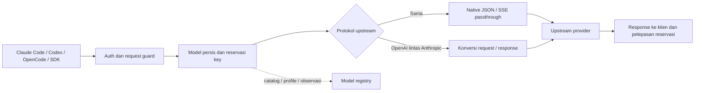

# Finalisasi produksi — 11 Oktober 2026

**Status release: LULUS verifikasi produksi untuk model, versi klien dan fitur yang diuji.**
Source final **db1a89e7**, mencakup cleanup SSE dashboard, sudah lulus seluruh
**delapan gate**, **954 unit test pada setiap Python environment**, rollout
**31/31**, serta browser produksi **7/7**. Qualification smoke CLI dan loop SDK
nyata lulus **18/18**. Tugas read-tool CLI terpisah lulus **9/9**, sehingga
qualification live selesai dengan **27 lulus, 0 gagal**. Pemeriksaan service
final setelah metadata qualification diperbarui juga lulus **14/14**.
Kelulusan smoke dan SDK tidak menggantikan tugas agent memakai tool aktual.
Metadata ketiga backend kini mencatat `live_production`, rollout `completed`
dan tanggal qualification 2026-10-11. Batas model dan fitur dijelaskan di bawah.
Dashboard tunggal berjalan di port **9105**, slot kosong
terendah dalam alokasi saat ini. Source, gate, verifikasi klien nyata dan
proses produksi dicatat terpisah; status lulus 2026-10-07 tidak otomatis
membuktikan seluruh qualification klien release 2026-10-11 sudah selesai.

Scope mengikuti [AGENTS.md](../AGENTS.md), [wrappers.json](../wrappers.json)
dan selector `common/wrapper_scope.py`. NVIDIA, Nous, OpenRouter serta
model-registry adalah backend aktif. **BLACKBOX dan provider OpenCode tetap
pending/frozen**: tidak dibaca, dianalisis, diedit, diuji, di-probe, dihentikan,
di-restart, di-install atau di-deploy. Perubahan lama di provider tersebut
tetap dipertahankan. OpenCode sebagai aplikasi klien boleh memakai backend aktif.

## Dashboard dan alokasi port

| Komponen | Port | Peran/status |
| --- | ---: | --- |
| Catalog/MCP eksternal | 9100 | Layanan proyek lain yang sudah memakai port; dipertahankan |
| NVIDIA | 9101 | Backend inference aktif |
| Nous | 9102 | Backend inference aktif |
| Provider OpenCode | 9103 | Reserved, pending/frozen; tanpa probe |
| BLACKBOX | 9104 | Reserved, pending/frozen; tanpa probe |
| Dashboard tunggal | 9105 | Home global dan dropdown per wrapper |
| OpenRouter | 9106 | Backend inference aktif |
| Model registry | 9200 | Control plane internal |

Buka **`http://127.0.0.1:9105/`** untuk dashboard tunggal. Port 9100 tidak
dipindahkan karena sudah dipakai layanan di luar scope wrapper. Port reserved
provider frozen tetap utuh. Origin inference NVIDIA/Nous/OpenRouter tidak berubah.

Halaman home menampilkan status global backend aktif. Dropdown berada di
navigasi atas, terpisah dari isi dashboard. Pemilihan wrapper inference
menampilkan dashboard lamanya tanpa menutup kontrol yang sudah ada;
model-registry ditampilkan sebagai status service karena tidak memiliki
halaman dashboard sendiri. Provider pending ditampilkan dari metadata saja,
tanpa membuka implementasi, dashboard, log atau runtime mereka.

Gateway dashboard meneruskan GET melalui allowlist ke port loopback yang
terdaftar pada metadata. Provider credential tidak dimuat. Readiness yang
memerlukan token ditampilkan sebagai protected/unknown sampai autentikasi
tersedia; HTTP health 200 tidak berarti backend siap inference. Operator
memakai prompt token dashboard wrapper yang sudah ada, dengan penyimpanan
browser terpisah per wrapper. Detail ada di [dashboard/README.md](../dashboard/README.md).

Service dashboard: `wrapper-dashboard.service`, entry point `dashboard.app:app`.
Service produksi memakai `0.0.0.0:9105`, dengan PID **83000** pada rollout
final 2026-10-11. Kelima service aktif/running dengan `NRestarts=0` pada
fingerprint db1a89e7 yang sama dengan gate.

## Workflow backend dan kontrak protokol

Klien memilih backend, **ID model persis**, serta surface API. Token lokal
wrapper mengautentikasi klien; credential provider tetap di server. Wrapper
memvalidasi request, menyelesaikan alias yang dikonfigurasi, mereservasi key,
lalu meneruskan request ke upstream yang sesuai.



- Chat→Chat, native Responses→Responses, dan Messages→Messages native
  mempertahankan field serta SSE, termasuk ekstensi native yang belum dikenal.
- `COMPATIBILITY_LAYER=1` mendeklarasikan upstream OpenAI, `2` Anthropic,
  dan `3` discovery. Konversi OpenAI↔Anthropic dilakukan lintas protokol.
- `RESPONSES_UPSTREAM_MODE=auto` mencoba native Responses dahulu. Adapter
  Responses→Chat hanya diizinkan untuk route definitif tidak didukung:
  **404, 405 atau 501**. Error model, auth, quota, generic 400, 5xx, timeout
  dan stream native sukses yang malformed tidak memicu downgrade.
- Retry quota/rate-limit/invalid-key memakai key lain yang tersedia untuk
  **model yang sama**. Exhaustion menjadi error yang dapat ditindaklanjuti;
  reservasi dilepas pada sukses, error dan cancellation.
- History adapter dibatasi TTL/jumlah/byte dan tenant. History native dimiliki
  upstream; kelulusan history lengkap tidak membuktikan `previous_response_id`
  tetap valid saat credential berganti. Context native yang tidak tersedia
  bagi adapter ditolak dengan petunjuk mengirim context lengkap.
- Nous menambahkan metadata product/client yang jujur ketika tags absen;
  tags caller dipertahankan, tanpa impersonasi klien lain.

Kontrol cross reasoning OpenRouter dan model NVIDIA/Nemotron yang diuji
memiliki mapping serta batas nilai yang dijelaskan pada
[setup klien](CLIENT_BACKEND_SETUP.md). **Kontrol budget/adaptive/effort
Messages→Chat pada Nous belum qualified setara dengan kontrol Anthropic.**
Jawaban reasoning atau smoke CLI yang berhasil tidak membuktikan setiap
kontrol itu dijalankan oleh upstream. Fitur cross baru dan versi klien baru
memerlukan regression; jangan menjanjikan semua pembaruan masa depan.

## Git, source dan deployment

Baseline Git yang diperiksa: `main`, HEAD
**`1825f876d30feca307ae1198be8e832073b78015`** (`1825f87`). Working tree
memiliki perubahan yang belum di-commit. Release harus dicatat sebagai
**source working tree**, bukan hanya SHA commit. Perubahan pengguna yang
sudah ada dipertahankan; tidak ada commit atau push dalam finalisasi ini.

Fingerprint **72 file source release aktif pada baseline final** dicatat pada
[manifest source](reports/active-source-manifest-20261011.json). SHA-256 gabungan:
`db1a89e77a89d32510644ee1f4178cd15b1cd25cbed9d528a3a40cc7620fa6b8`.
Seluruh fingerprint baseline tetap identik sepanjang gate final dan rollout.
Manifest tidak memuat credential atau source provider frozen. Setelah seluruh
test selesai, hanya metadata qualification dalam `wrappers.json` diperbarui;
kode runtime, port, lifecycle dan dictionary provider pending tetap sama.
Manifest mencatat perubahan tersebut pada `post_verification_metadata_update`:

| Fingerprint | SHA-256 |
| --- | --- |
| Baseline 72 file yang diuji dan di-deploy | `db1a89e77a89d32510644ee1f4178cd15b1cd25cbed9d528a3a40cc7620fa6b8` |
| `wrappers.json` setelah metadata qualification final | `78705b1e3ec7d405f9466ffbf9aefc73ba26b0e933ba26e73d7840a892287c41` |
| Release efektif setelah update metadata saja | `7f9ea19bd251a05211aff86df357c9f96e25069299ff208d34e3113e728116db` |

Digest efektif tersebut tidak diklaim sebagai baseline test baru. Perbedaannya
adalah metadata bukti qualification setelah verifikasi; source runtime tetap
sama dengan baseline gate dan rollout. Dokumentasi berada di luar fingerprint ini.

[Rollout final](reports/active-production-rollout-20261011.json) mencatat
**31 pemeriksaan lulus, 0 gagal**, termasuk readiness, autentikasi, JSON
null/error shape, catalog model pilihan, serta konfigurasi native-first.
Environment aktif serta unit provider yang sudah terpasang dipertahankan persis;
`RESPONSES_UPSTREAM_MODE=auto` tetap berlaku pada ketiga backend.

| Service pada rollout final | PID | Status snapshot |
| --- | ---: | --- |
| Dashboard | 83000 | active/running, NRestarts 0 |
| Model registry | 83016 | active/running, NRestarts 0 |
| NVIDIA | 83035 | active/running, NRestarts 0 |
| Nous | 83063 | active/running, NRestarts 0 |
| OpenRouter | 83112 | active/running, NRestarts 0 |

PID dan waktu mulai merupakan snapshot rollout, bukan identifier permanen.
[Rollout sebelum cleanup dashboard](reports/active-production-rollout-before-dashboard-cleanup-20261011.json)
dan [manifest ec41cb1e](reports/active-source-manifest-before-dashboard-cleanup-20261011.json)
tetap disimpan sebagai bukti release sebelumnya. Source pertama d7c359bb dan
snapshot service awal berada pada [manifest initial](reports/active-source-manifest-initial-20261011.json)
serta [rollout initial](reports/active-production-rollout-initial-20261011.json).

## Bukti release 2026-10-11

| Pemeriksaan | Status saat ini | Bukti |
| --- | --- | --- |
| Runtime, SDK, matrix, compatibility, acceptance, soak, transparency dan unit | **PASS — 8/8 gate pada db1a89e7** | [Ringkasan gate final](../artifacts/production-final-20261011/production-gates-summary.json) |
| Unit penuh pinned dan Python deployment | **PASS — 954 masing-masing; 105 excluded masing-masing** | [Pinned](../artifacts/production-final-20261011/unit-final.log), [Python deployment](../artifacts/production-final-20261011/unit-deployed-runtime.log) |
| Dashboard transport SSE cleanup | **PASS — 28 regression terarah dan unit final** | [Regression dashboard](../tests/test_unified_dashboard.py), [gate final](../artifacts/production-final-20261011/production-gates-summary.json) |
| Browser dashboard pada service produksi 9105 | **PASS — 7/7 fresh setelah rollout db1a89e7** | [Browser live final](../artifacts/production-final-20261011/dashboard-browser-live.json) |
| Smoke CLI dan loop SDK nyata | **PASS — 18/18 pada backend source yang sama** | [Qualification live](reports/live-client-qualification-20261011.json) |
| Tugas read-tool Claude Code, Codex dan OpenCode | **PASS — 9/9; total qualification live 27/27** | [Qualification read-tool final](reports/live-agent-read-qualification-20261011.json), [attempt 1 tersimpan](reports/live-agent-read-qualification-attempt1-20261011.json), [attempt 2 tersimpan](reports/live-agent-read-qualification-attempt2-20261011.json) |
| Manifest baseline final dan metadata qualification | **DEPLOYED — 72 file baseline db1a89e77a89…; metadata final tercatat terpisah** | [Manifest final](reports/active-source-manifest-20261011.json) |
| Rollout, proses service dan readiness | **PASS — 31/31, 0 gagal; lima service active/running** | [Rollout final](reports/active-production-rollout-20261011.json) |
| Pemeriksaan akhir setelah update metadata | **PASS — 14/14; PID tetap, NRestarts 0, source runtime sama** | [Verifikasi final](reports/active-production-final-verification-20261011.json) |

Qualification read-tool final sudah lulus melalui rerun sembilan kombinasi
setelah perbaikan helper/configuration. Report failed attempt tetap dipertahankan.
Unit terbaru setelah regression helper mencatat 954 lulus pada masing-masing
Python. Guard memverifikasi baseline 72 file release dan enam helper qualification
tetap sama selama unit final. Metadata qualification kemudian diperbarui setelah
seluruh 27 pemeriksaan live dan kedua unit penuh lulus.

| Gate pada source final db1a89e7 | Hasil aktual |
| --- | --- |
| Runtime | 267 lulus, 0 gagal |
| SDK | 12 lulus, 0 gagal |
| Matrix | 144 lulus, 0 gagal, 0 blocked |
| Compatibility | 45 lulus, 0 gagal |
| Acceptance native/cross/auto | 141 lulus, 0 gagal |
| Soak | 6.204 berhasil: NVIDIA 1.999, Nous 2.344, OpenRouter 1.861; 0 gagal/429/isu log |
| Transparency | PASS |
| Unit pinned | 954 lulus, 0 gagal; 105 excluded; 1 warning Starlette TestClient; 100,60 detik pytest, 103,145 detik subprocess |
| Unit Python deployment | 954 lulus, 0 gagal; 105 excluded; 0 warning; 94,18 detik pytest, 96,285 detik subprocess |

Warning pinned berasal dari deprecation `httpx` pada Starlette TestClient.
Excluded provider frozen/campuran dipilih sebelum read/import dan tidak
ditambahkan ke jumlah test lulus. Soak memakai 15 detik per wrapper dengan
concurrency 6; hasil tersebut bukan bukti SLA atau kapasitas provider nyata.

Runner `tests/run_production_gates.sh` menghasilkan `scope.json`, `matrix.json`,
`acceptance.json` dan log delapan gate di `artifacts/production-final-20261011/`.
Ringkasan aggregate disusun dari hasil aktual dan unit kedua environment.
Tujuh gate non-unit tetap memakai source db1a89e7 yang tidak berubah; unit penuh
diulang setelah correction helper. Invocation delapan gate sebelumnya dengan
945 unit PASS tetap tersimpan sebagai bukti terdahulu, bukan digabung sebagai
test tambahan pada 954 hasil final.
Runtime/SDK/matrix/compatibility/soak juga memuat fixture legacy Chat adapter
yang eksplisit; acceptance menguji default produksi auto/native-first dan
fallback hanya ketika route upstream definitif tidak didukung. Gate memakai
upstream terkontrol, fake credential, port dan database terisolasi; qualification
provider nyata memiliki bukti terpisah.

Browser fresh setelah rollout final memverifikasi enam kartu global, tiga
dashboard inference di iframe dengan storage terisolasi, menu yang tidak
menumpuk isi dashboard, status registry, serta viewport mobile 390 piksel.
Tidak ada request provider frozen maupun error JavaScript pada tujuh pemeriksaan.

## Qualification klien nyata yang selesai

Qualification final mencakup **27 pemeriksaan yang berbeda**: sembilan smoke
CLI, sembilan loop SDK dua putaran, dan sembilan tugas CLI membaca fixture lewat
tool. Smoke serta SDK **18/18 PASS** dan read-tool **9/9 PASS**; total
**27/27 PASS**, tanpa mengganti model.
Versi yang diuji: Claude Code **2.1.202**, Codex **0.160.1**, OpenCode client
**1.17.20**, SDK OpenAI **2.54.0**, dan SDK Anthropic **0.125.0**.
SDK loop mencakup OpenAI Chat, native Responses dan Anthropic Messages,
dengan argumen tool tepat `{"value":"OK"}`, tanpa menerima JSON malformed atau
field tambahan. Bukti live memakai source 42 file backend/common yang tidak
berubah antara ec41cb1e dan db1a89e7; perubahan terakhir hanya dashboard.

| Backend | Model eksplisit | Smoke CLI + SDK | Read-tool final |
| --- | --- | --- | --- |
| NVIDIA | `nvidia/nemotron-3-super-120b-a12b` | 6/6 PASS | Claude, Codex dan OpenCode 3/3 PASS |
| Nous | `poolside/laguna-xs-2.1:free` | 6/6 PASS | Claude, Codex dan OpenCode 3/3 PASS |
| OpenRouter | `liquid/lfm-2.5-2.6b:free` | 6/6 PASS | Claude, Codex dan OpenCode 3/3 PASS |

Helper Codex kini memakai katalog metadata tugas untuk ID model persis dan
`/usr/bin/cat` absolut pada shell tanpa inherited PATH. Helper OpenCode memakai
satu sumber permission berurutan, tanpa legacy agent.tools, dan allow hanya
fixture unik dalam bentuk absolut serta relatif terhadap worktree `/`.
[Uji NVIDIA + OpenCode 1/1](reports/nvidia-opencode-read-worktree-qualification-20261011.json)
lulus setelah koreksi; rerun sembilan kombinasi juga telah lulus.
Lihat [panduan klien](CLIENT_BACKEND_SETUP.md#qualification-tool-baca-oleh-agent).
Kegagalan attempt sebelumnya tetap tersimpan terpisah dari qualification final.
Kelulusan pada model/client di tabel bukan klaim semua model,
semua workload, ataupun semua versi klien mendatang.

## Perbaikan dan bukti historis yang dipertahankan

Qualification live pertama mencatat **13 PASS dan 5 FAIL** pada
[attempt 1](reports/live-client-qualification-attempt1-20261011.json). Kontrol
tools `strict` yang hilang pada cross-conversion diperbaiki pada converter aktif.
Native OpenRouter tetap passthrough: model menghasilkan argumen tool JSON rusak
ketika schema object kosong dipakai pada attempt tersebut. Limitasi upstream
itu tetap tercatat meskipun qualification ulang dengan schema required `value`
string enum `OK` dan `strict=true` kemudian lulus. Parser tidak dilonggarkan
untuk menerima JSON rusak atau field ekstra.

Repeat Claude/Nous menghasilkan jawaban persis OK pada
[diagnosis format](reports/nous-claude-format-diagnosis-20261011.json).
Jawaban awal yang tidak persis OK tetap gagal pada attempt 1; repeat tidak
mengubah bukti historis. Variasi format model dibedakan dari terminal/protokol
backend yang berhasil.

[Attempt live 2](reports/live-client-qualification-attempt2-20261011.json)
mencatat 16 PASS dan 2 FAIL karena tanda baca dalam jawaban smoke Nous.
Final 18/18 menggunakan validasi literal ASCII tanpa normalisasi jawaban,
perubahan model, ataupun pelonggaran parser. Format persis tetap membutuhkan
validasi aplikasi terhadap output model.

Read-tool attempt 1 mencatat 3/9 PASS dan attempt 2 mencatat 6/9 PASS. Diagnosis
menemukan metadata katalog custom Codex dan executable shell tanpa inherited
PATH, serta normalisasi legacy tools/urutan permission dan worktree `/` pada
OpenCode. Helper diperbaiki pada konfigurasi fixture; provider routing dan
konversi runtime tidak diubah untuk meluluskan test tersebut. Rerun final 9/9
memerlukan hasil tool nyata serta nonce file dalam jawaban akhir, tanpa command
atau path yang tidak diizinkan dan tanpa perubahan fixture.

Acceptance sebelum cleanup mencatat **140 PASS dan 1 FAIL cancellation** pada
[attempt tersimpan](../artifacts/production-pre-cancellation-fix-20261011/acceptance.json).
Perbaikan ownership streaming menutup resource yang telah diperoleh sebelum
generator mulai, menunggu read task serta iterator bertingkat, dan melepas key
secara idempotent. Adapter Responses NVIDIA tetap cleanup ketika klien berhenti
pada event sintetis awal. Regression NVIDIA mencatat **227 PASS pada kedua
Python**, termasuk 73 kasus ownership; bukti terarah tersimpan di
[arsip sebelum fix dashboard](../artifacts/production-pre-dashboard-cleanup-20261011/nvidia-stream-ownership-targeted.json)
dan seluruh test terkait ikut unit final.

Review dashboard menemukan bahwa BackgroundTask tidak berjalan saat send
ASGI 2.4 gagal sehingga slot SSE bisa tertahan. Cleanup response kini eksplisit
dan idempotent, diverifikasi oleh regression terarah serta seluruh delapan gate
ulang pada db1a89e7. [Gate ec41cb1e](../artifacts/production-pre-dashboard-cleanup-20261011/production-gates-summary.json)
berisi 939 unit PASS dan soak 5.731 sebelum fix dashboard; angka tersebut tidak
menggantikan 954 unit dan soak 6.204 pada release final.

Run unit ec41cb1e sebelumnya juga memiliki guard source-only R05 yang membaca
potongan route 4.500 karakter, sehingga menghasilkan **938 PASS dan 1 FAIL**
ketika call converter berada di luar potongan itu. Guard test kemudian memakai
fungsi AST lengkap; executable source saat itu tidak berubah. Bukti serta
rerun 939 PASS disimpan pada arsip sebelum fix dashboard. Guard tersebut
terpisah dari runtime yang menguji perilaku konversi aktual.

[Gate putaran pertama](../artifacts/production-first-pass-20261011/production-gates-summary.json)
mencatat unit 663 PASS, 105 excluded serta soak 6.829 sebelum perbaikan strict
dan cleanup. Seluruh attempt terdahulu tetap historis; approval source final
menggunakan hasil db1a89e7 di atas.

Untuk menjalankan gate source aktif:

```bash
PYTHON_BIN=/path/to/verified/venv/bin/python \
  bash tests/run_production_gates.sh \
  --output-dir artifacts/production-final-20261011 \
  --soak-seconds 15 --concurrency 6
```

## Qualification terdahulu yang tetap berguna

Pada **2026-10-07**, model berikut lulus ketiga CLI dan tool roundtrip pada
endpoint produksi. Hasil tersebut historis dan tidak menggantikan gate release ini.

| Backend | Model pilihan eksplisit | CLI live | Tools live |
| --- | --- | --- | --- |
| NVIDIA | `nvidia/nemotron-3-super-120b-a12b` | [3/3](reports/nvidia-python-production-client-cli-20261007.json) | [3/3](reports/nvidia-python-production-tool-loops-20261007.json) |
| Nous | `poolside/laguna-xs-2.1:free` | [3/3](reports/nous-production-client-cli-20261007.json) | [3/3](reports/nous-production-tool-loops-20261007.json) |
| OpenRouter | `liquid/lfm-2.5-2.6b:free` | [3/3](reports/active-production-client-cli-20261007.json) | [3/3](reports/active-production-tool-loops-20261007.json) |

Versi smoke saat itu: Claude Code 2.1.202, Codex 0.160.1 dan OpenCode client
1.17.20. Native SDK accumulation OpenAI 2.31/2.54 juga diuji di staging.
Native Responses pada model NVIDIA `openai/gpt-oss-20b` dan Nous
`upstage/solar-mini4:free` memiliki batas model yang tercatat pada
[diagnosis sebelumnya](reports/active-native-response-diagnosis-20261007.json).
Operator memilih model qualified secara eksplisit; tidak ada fallback model otomatis.
